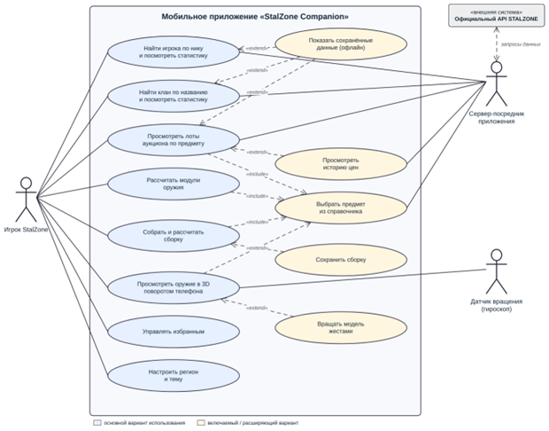
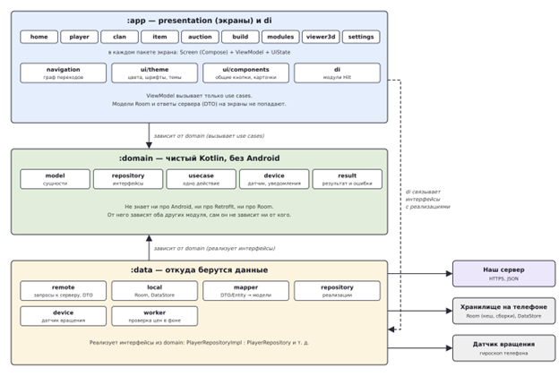
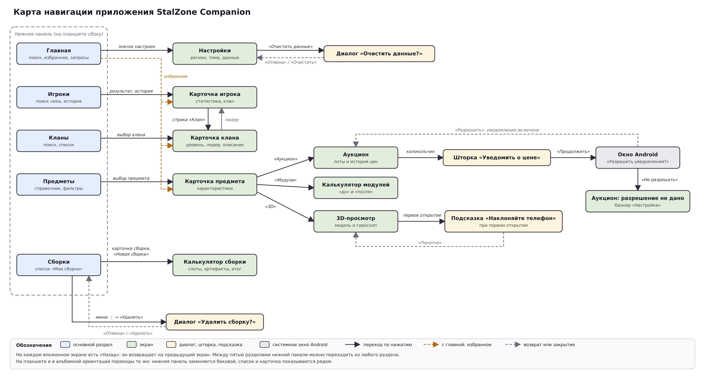

# StalZone Companion

Мобильное приложение-компаньон для игроков [StalZone](https://store.epicgames.com/p/stalzone-057c4a) (до июня 2026 года — STALCRAFT: X). Учебный проект по дисциплине «Мобильная разработка на Kotlin».

StalZone выходит только на ПК, и вне компьютера игрок не может посмотреть цены аукциона, статистику или прикинуть сборку. Приложение собирает всё это в одном месте на телефоне и работает на сохранённых данных даже без интернета.

> Неофициальное фанатское приложение, не связано с EXBO. Игровые данные получены из официального API и открытой базы предметов EXBO.

## Идея

**Проблема.** Игра доступна только на ПК. Цены аукциона, статистика игроков и кланов, расчёт снаряжения разбросаны по игре и по разным сайтам, которые неудобны на телефоне.

**Для кого.** Для всех игроков StalZone с Android-смартфоном или планшетом: новичков, торговцев, клановых игроков и опытных игроков.

**Что умеет приложение.**

| Функция | Что делает |
|---|---|
| Статистика игрока | Поиск по нику, профиль, клан и показатели |
| Статистика кланов | Поиск по названию, карточка клана |
| Аукцион | Текущие лоты предмета и история цен |
| Калькулятор сборок | Броня, контейнер, артефакты и oружие: итоговые характеристики и стоимость |
| Калькулятор модулей | Характеристики oружия «до» и «после» установки модулей |
| 3D-просмотр oружия | Модель поворачивается вслед за поворотом телефона (датчик вращения) |
| Избранное и офлайн | Сохранённые игроки, кланы, предметы и сборки доступны без сети |

## Аналоги

Готовых мобильных приложений для StalZone нет, есть только сайты. «+» — функция есть, «±» — есть частично, «–» — не найдена.

| Критерий | stalzone.wiki | SC Tools | Stalzone Monitor | Lunar | StalzoneHQ | Наш проект |
|---|---|---|---|---|---|---|
| Мобильное приложение | – | – | – | – | – | + |
| Цены аукциона | – | ± | + | + | – | + |
| Статистика игрока по нику | ± | – | ± | + | + | + |
| Статистика кланов | – | – | – | + | + | + |
| Калькулятор сборок | + | + | – | + | ± | + |
| Калькулятор модулей | + | – | – | ± | – | + |
| 3D-просмотр с гироскопом | – | – | – | – | – | + |
| Работа без интернета | – | – | – | – | – | + |
| Русский интерфейс | + | + | + | + | – | + |

Ближе всего к проекту сайт Lunar, но это сайт: он не работает без интернета и не использует датчики телефона.

## Ценность для пользователя

- экономия времени: цена, статистика и расчёт сборки в одном приложении, без запуска игры и поиска по сайтам;
- экономия игровой валюты: сборку и модули можно оценить по стоимости до покупки;
- доступность вне компьютера и без интернета, на сохранённых данных;
- наглядность: oружие можно рассмотреть в 3D, поворачивая телефон.

## Источник данных и аппаратная функция

- **Источники данных:** официальный API StalZone (EXBO), [открытая база предметов EXBO](https://github.com/EXBO-Studio/stalcraft-database).
- **Аппаратная функция:** датчик вращения (гироскоп) для 3D-просмотра oружия.

Подробнее — в [карточке идеи](docs/01-idea.docx).

## Техническое задание

**Цели.** Смотреть цены аукциона с телефона, быстро искать игроков и кланы, планировать сборку и модули до траты игровой валюты, рассматривать oружие в 3D.

В [техническом задании](docs/02-tz.docx) описаны функции по подсистемам с приоритетами (MoSCoW), нефункциональные требования, пользовательские истории с критериями приёмки, требования к ошибкам и работе без интернета.

## Архитектура и стек

- **Приложение:** Kotlin, Jetpack Compose, Material 3, Clean Architecture (domain / data / presentation), MVVM с UiState, Hilt, Coroutines/Flow, Retrofit + kotlinx.serialization, Room, DataStore, SceneView, Kover.
- **Сервер-посредник:** хранит ключи официального API (в APK их нет), кеширует ответы и ищет кланы по названию. Технологии и размещение сервера выбираются позже.
- **Источники данных:** официальный API StalZone (EXBO), [открытая база предметов EXBO](https://github.com/EXBO-Studio/stalcraft-database).
- **Аппаратная функция:** датчик вращения (гироскоп) для 3D-просмотра; доступ скрыт за интерфейсом `DeviceOrientationProvider`.

Обоснование выбора — в [docs/03-stack.docx](docs/03-stack.docx).

## Устройство приложения

Проект делится на три Gradle-модуля: `:domain` (чистый Kotlin, без Android), `:data` (сервер, база Room, настройки, датчик) и `:app` (экраны, ViewModel, UiState, Hilt). Зависимости направлены только внутрь, к `domain`.

Компоненты приложения и интерфейсы между ними (шарик — интерфейс предоставляется, полукруг — интерфейс нужен):

В `domain` описаны 13 интерфейсов (репозитории, датчик, уведомления) и 29 use cases (один use case — одно действие). В документе также есть таблица «принцип SOLID — конкретный класс».

Подробнее — в [docs/04-architecture.docx](docs/04-architecture.docx).

## Дизайн-система

Тёплая янтарная палитра в светлой и тёмной теме, проверена по WCAG AA (13 пар «текст — фон», все проходят).

| Роль | Светлая тема | Тёмная тема |
|---|---|---|
| Основной (кнопки, акценты) | `#8A5100` | `#FFB870` |
| Дополнительный | `#5D6143` | `#C5CAA5` |
| Ошибка | `#BA1A1A` | `#FFB4AB` |
| Фон экрана | `#FCF9F2` | `#16130E` |
| Основной текст | `#1E1B16` | `#E9E1D8` |

Шрифты: **Rubik** для заголовков и цифр (20–24 sp), **Roboto** для основного текста, кнопок и подписей (12–16 sp). Шаг отступов 4 dp, поля от края экрана 16 dp.

Подробнее, с таблицами цветов, контраста и компонентов, — в [docs/05-design-system.docx](docs/05-design-system.docx).

Дизайн в Figma: [StalZone Companion — дизайн-система](https://www.figma.com/design/o4eNHYZp6f3tfTuubjydPL).

## Макеты экранов

Макеты нарисованы в [файле Figma](https://www.figma.com/design/o4eNHYZp6f3tfTuubjydPL) на странице «Обложка и экраны» из компонентов дизайн-системы. Картинки экспортированы в [docs/design/](docs/design/).

Девять экранов: «Главная», «Игроки», «Кланы», «Предметы», «Аукцион», «Сборки», «Модули», «3D-просмотр», «Настройки». У экранов нарисованы состояния: данные, загрузка, пустой результат, ошибка сервера, нет интернета. Для уведомлений о цене есть запрос разрешения, для 3D-просмотра — состояние «нет гироскопа».

Все экраны сделаны в светлой и тёмной теме. Для планшета и альбомной ориентации есть отдельные макеты.

## Прототип и навигация

Интерактивный прототип собран в том же [файле Figma](https://www.figma.com/design/o4eNHYZp6f3tfTuubjydPL), что и макеты: экраны связаны переходами, как в приложении. Есть светлая и тёмная тема.

[Прототип](https://www.figma.com/proto/o4eNHYZp6f3tfTuubjydPL/StalZone-Companion-%E2%80%94-%D0%B4%D0%B8%D0%B7%D0%B0%D0%B9%D0%BD-%D1%81%D0%B8%D1%81%D1%82%D0%B5%D0%BC%D0%B0?node-id=47-606&p=f&t=SEmX0QZVGpIw7qIy-1&scaling=min-zoom&content-scaling=fixed&page-id=0%3A1&starting-point-node-id=46%3A394&show-proto-sidebar=1)

Как смотреть: открыть ссылку и выбрать сценарий в левом верхнем углу. Основной сценарий начинается с экрана «Главная».

### Карта навигации

Пять разделов нижней панели (Главная, Игроки, Кланы, Предметы, Сборки) доступны с любого экрана, где есть панель. На планшете и в альбомной ориентации панель стоит сбоку, переходы те же.

### Основные переходы

| Откуда | Действие | Куда |
|---|---|---|
| Главная | значок настроек | Настройки |
| Главная | строка избранного, недавний запрос | карточка игрока, клана или предмета |
| Игроки | запрос из истории | карточка игрока |
| Кланы | результат поиска | карточка клана |
| Предметы | строка предмета | карточка предмета |
| Карточка игрока | строка «Клан» | карточка клана |
| Карточка клана | строка «Лидер» | карточка игрока |
| Карточка предмета | «Аукцион», «Модули», «3D» | одноимённый экран |
| Аукцион | вкладки «Лоты» и «История» | переключение вкладок |
| Аукцион | колокольчик | шторка «Уведомить о цене», затем окно Android |
| 3D-просмотр | первое открытие | подсказка «Наклоняйте телефон», кнопка «Понятно» |
| Сборки | карточка сборки или «+» | калькулятор сборки |
| Сборки | меню ⋮ | подтверждение удаления |
| Настройки | «Очистить сохранённые данные» | диалог, затем сообщение |

### Состояния в прототипе

- Экраны «Загрузка» сами переходят на экран с данными через 1,5 секунды.
- Кнопки «Повторить» на экранах ошибки ведут на экран с данными.
- «Пусто», «Ошибка сервера» и «Нет интернета» открываются выбором сценария. Всего 41 сценарий в светлой теме и 41 в тёмной.
- Планшет и альбомная ориентация показаны отдельными сценариями без переходов.

Замечаний по практике 6 не было.

## Документация

| Документ | Практика |
|---|---|
| [docs/01-idea.docx](docs/01-idea.docx) — карточка идеи, аналоги, ценность | 1 |
| [docs/02-tz.docx](docs/02-tz.docx) — техническое задание, диаграмма вариантов использования | 2 |
| [docs/03-stack.docx](docs/03-stack.docx) — выбор стека, архитектуры и серверной части | 3 |
| [docs/04-architecture.docx](docs/04-architecture.docx) — слои, сущности, репозитории, use cases, SOLID | 4 |
| [docs/05-design-system.docx](docs/05-design-system.docx) — палитра, контраст, шрифты, отступы, компоненты | 5 |
| [docs/design/](docs/design/) — макеты экранов со всеми состояниями, планшет, альбомная ориентация, тёмная тема | 6 |
| [docs/diagrams/07-navigation.png](docs/diagrams/07-navigation.png) — карта навигации; ссылка на прототип в разделе «Прототип и навигация» | 7 |

## Этапы

| Этап | Практики | Тег | Статус |
|---|---|---|---|
| 1. Идея и ТЗ | 1–3 | `v0.1-spec` | готово |
| 2. Архитектура и дизайн | 4–7 | `v0.2-design` | готово |
| 3. Серверная часть | 8–11 | `v0.3-backend` | — |
| 4. Разработка приложения | 12–24 | `v0.9-mvp` | — |
| 5. Тестирование | 25–27 | `v1.0-rc` | — |
| 6. Релиз и защита | 28–30 | `v1.0` | — |

## Сборка и запуск

Инструкция появится вместе с кодом приложения (этап 4). Требования: Android Studio, JDK 17, устройство или эмулятор с Android 8.0 и выше.

## Правила репозитория

- Коммиты по [Conventional Commits](https://www.conventionalcommits.org/ru/): `feat:`, `fix:`, `test:`, `docs:`, `refactor:`, `chore:`.
- Работа в фича-ветках, слияние в `main` через pull request.
- Тег на каждый завершённый этап.